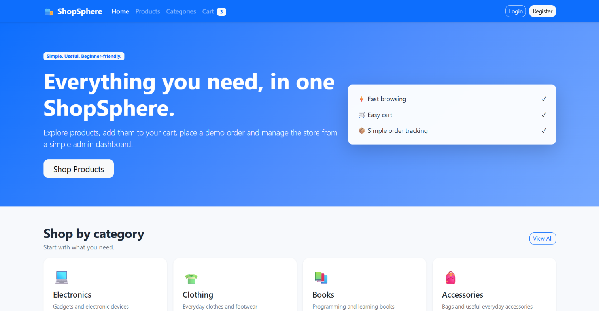
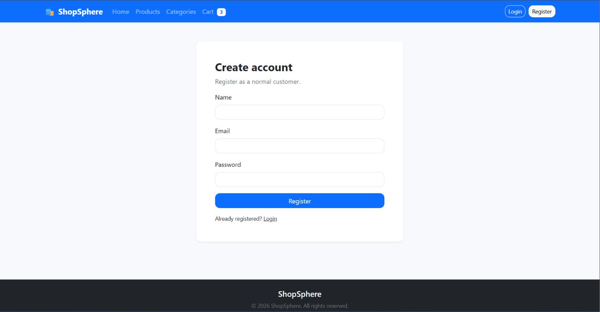
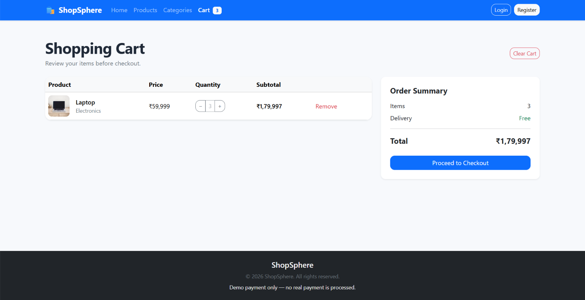

# ShopSphere — E-Commerce Platform

ShopSphere is a full-stack e-commerce web application built with React.js and Spring Boot. It provides product browsing, categories, a shopping cart, checkout, order management, and an admin dashboard.

## Features

- Browse and search products
- Browse product categories
- Shopping cart and checkout
- User registration and login
- Order placement and order tracking
- Admin dashboard for managing products, categories, users, and orders

## Tech Stack

**Frontend:** React.js, React Router, Axios, Bootstrap, Vite

**Backend:** Java, Spring Boot, Spring Data JPA, Hibernate, Maven

**Database:** MySQL

## Project Structure

- `frontend/` — React frontend
- `backend/` — Spring Boot REST API
- `database/` — SQL schema and sample data
- `README.md` — Project documentation

## Run Locally

### 1. Database

- Start MySQL.
- Create the database `ecommerce_db`, or execute the provided SQL script if needed.
- Configure your local database credentials in `backend/src/main/resources/application.properties`.

Use `application.properties.example` as a reference for the required configuration.

### 2. Backend

Open a terminal in `backend/` and run:

```bash
./mvnw spring-boot:run
```

On Windows Command Prompt, use:

```bat
mvnw.cmd spring-boot:run
```

The backend is configured to run on port `8181`.

### 3. Frontend

Open another terminal in `frontend/` and run:

```bash
npm install
npm run dev
```

Open the local URL printed by Vite in your terminal.

## Security

Do not commit database passwords, API keys, or other secrets. Configure credentials locally before running the application.

## Note

This project is intended for learning and demonstration purposes. Payment functionality, if present, is for demo use only.

## Screenshots

### Home Page


### Products Page


### Main Page


### Login / Register


### Shopping Cart
